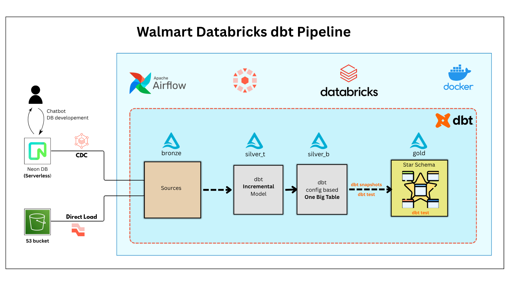
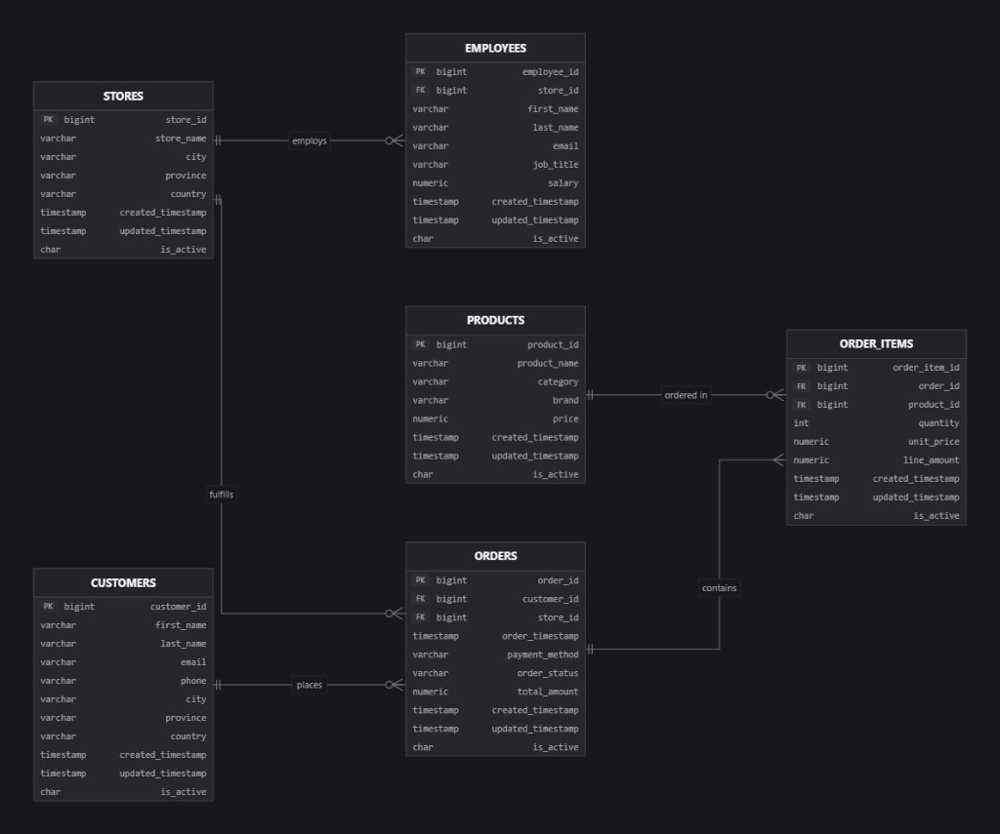
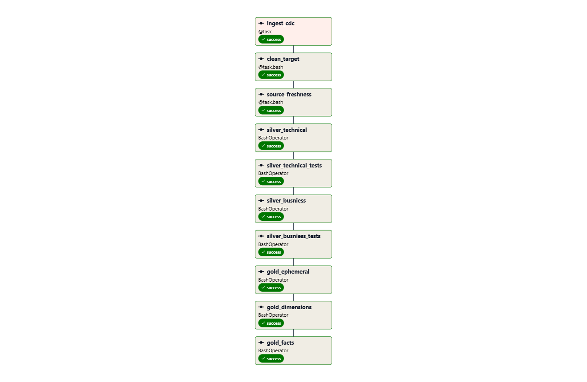
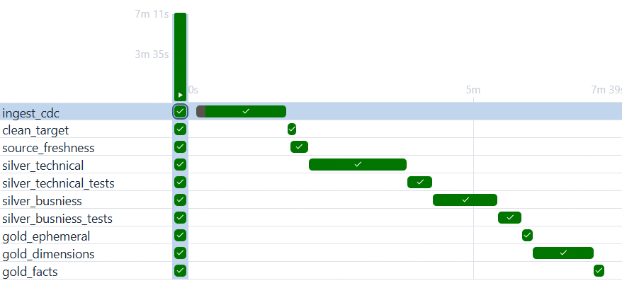

# 🛒 Walmart-databricks-dbt-pipeline
An end-to-end Lakehouse pipeline using Neon Postgres, Databricks, dbt Core, and Apache Airflow.


---

## 🧭 Setup Guides

| Module | Description | Guide Link |
| :--- | :--- | :--- |
| **🐘 Source Database Setup** | Provision Neon Serverless Postgres, create schemas, and seed raw datasets. | [**Walmart Neon DB Setup Guide**](Walmart%20Neon%20DB%20Postgres%20Setup/README.md) |
| **⚡ Orchestration & dbt** | Deploy Dockerized Airflow, trigger Databricks CDC, and run dbt transformations. | [**Airflow, dbt & Docker Setup Guide**](databricks-dbt-project/README.md) |

---

## 🏗️ Architecture

Retail transaction data originates in an OLTP database, syncs into the Databricks Lakehouse via CDC, transforms through a Medallion architecture using dbt Core, and runs on an automated daily Airflow schedule.



### Tech Stack
- **OLTP Source**: Neon Serverless Postgres
- **Lakehouse Platform**: Databricks (Delta Lake, Unity Catalog, SQL Warehouse)
- **Transformations**: dbt Core (`dbt-databricks`)
- **Orchestration**: Apache Airflow 3.4.0 (Dockerized CeleryExecutor)

---

## 🗄️ Relational Data Model (ERD)

The source database models retail sales, store operations, product catalogs, and staffing across 6 relational entities:



| Entity | Description | Primary Key | Foreign Keys |
| :--- | :--- | :--- | :--- |
| **`customers`** | Customer demographic and location records | `customer_id` | — |
| **`stores`** | Retail store locations and operating details | `store_id` | — |
| **`products`** | Product catalog items and category pricing | `product_id` | — |
| **`employees`** | Store staff members and compensation | `employee_id` | `store_id` |
| **`orders`** | Transaction headers and payment status | `order_id` | `customer_id`, `store_id` |
| **`order_items`** | Line-item quantities and prices per order | `order_item_id` | `order_id`, `product_id` |

---

## 💎 Medallion Architecture

Transformations in Databricks follow a three-tier Medallion architecture:

```
Bronze (Raw Ingest) ──► Silver Technical (Cleaning) ──► Silver Business (OBT) ──► Gold Marts (Facts & Dimensions)
```

| Layer | Catalog / Schema | Purpose | Models |
| :--- | :--- | :--- | :--- |
| **Bronze** | `walmart.bronze` | Raw, immutable data ingested from Postgres via CDC | `customers`, `orders`, `products`, etc. |
| **Silver Technical** | `walmart.silver_t` | Type casting, null handling, deduplication, surrogate keys | `customers_t`, `orders_t`, `products_t`, etc. |
| **Silver Business** | `walmart.silver_b` | Denormalized One Big Table joining all relational dimensions | `obt_b` |
| **Gold** | `walmart.gold` | Dimensional star schema and historical snapshots (SCD Type 2) | `fct_orders`, `dim_*` snapshots |

---

## ⏱️ Airflow Orchestration

The Airflow DAG (`orchestrate`) runs daily at `11:00 UTC` and enforces strict end-to-end task dependencies:



```
ingest_cdc ──► clean_target ──► source_freshness ──► silver_technical ──► silver_technical_tests ──► silver_business ──► silver_business_tests ──► gold_ephemeral ──► gold_dimensions ──► gold_fact
```

### Execution Timeline


---

## 📁 Repository Structure

```text
Walmart-databricks-dbt-pipeline/
├── README.md                           # Main documentation
├── assets/                             # Pipeline, DAG, and ER diagrams
├── datasets/                           # Raw CSV datasets, schema DDL, and loader script
│   ├── data/
│   ├── ddl/
│   └── load_data.py
├── Walmart Neon DB Postgres Setup/     # Source database setup and configuration
│   ├── README.md
│   ├── neon.ts
│   ├── main.py
│   └── .env.example
└── databricks-dbt-project/             # Dockerized Airflow & dbt Core project
    ├── README.md
    ├── Dockerfile
    ├── docker-compose.yaml
    ├── requirements.txt
    ├── dags/
    │   └── orchestrate.py
    └── walmart_project/                # dbt project root
        ├── dbt_project.yml
        ├── profiles.yml.example
        ├── models/
        ├── snapshots/
        └── tests/
```
