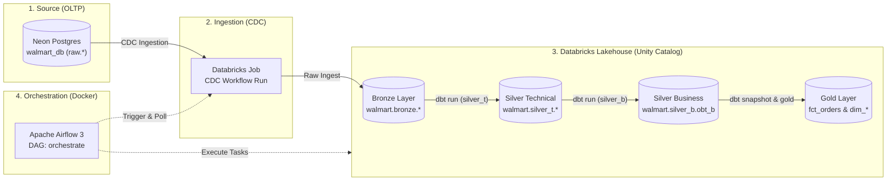
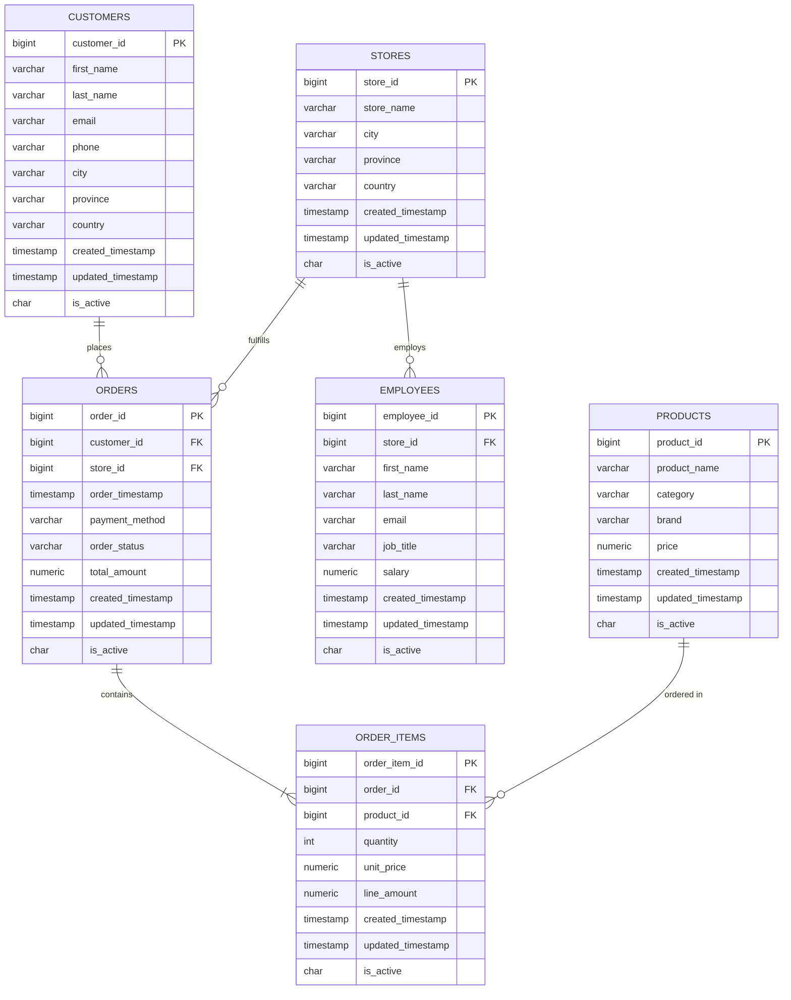

# 🛒 Walmart-databricks-dbt-pipeline
### End-to-End Lakehouse Orchestration with Neon Postgres, Databricks, dbt Core & Apache Airflow


---

## 🧭 Interactive Learning Guides

This repository is built as a complete modular reference project for modern Data Engineering. Jump directly to either setup guide below:

| Guide | Description | Quick Link |
| :--- | :--- | :--- |
| **🐘 1. Source Database Setup** | Provision Neon Serverless Postgres, run DDL schemas, and bulk-load raw Walmart datasets. | [**👉 Walmart Neon DB Setup Guide**](Walmart%20Neon%20DB%20Postgres%20Setup/README.md) |
| **⚡ 2. Orchestration & dbt** | Spin up the Dockerized Airflow 3 stack, configure Databricks credentials, and execute Medallion dbt models. | [**👉 Airflow, dbt & Docker Setup Guide**](databricks-dbt-project/README.md) |

---

## 🏗️ System Architecture & Data Flow

The project mirrors a modern enterprise e-commerce / retail data platform. Transactional data originates in an OLTP database, synchronizes into Databricks Lakehouse storage via Change Data Capture (CDC), transforms across a strict **Medallion Architecture** using **dbt Core**, and is fully scheduled and monitored by **Apache Airflow**.




---

## 🗄️ Entity-Relationship (ER) Diagram: Source Relational Model

The source OLTP database in **Neon Postgres** models Walmart's retail sales, store operations, inventory products, and store employees:




### Relational Schema Cardinality & Business Rules:
- **`CUSTOMERS` ➔ `ORDERS` (1:N)**: A customer can place multiple orders; an order must belong to exactly one customer.
- **`STORES` ➔ `ORDERS` (1:N)**: A physical or online store fulfills many customer orders.
- **`STORES` ➔ `EMPLOYEES` (1:N)**: Employees are assigned to a specific store location (`store_id`).
- **`ORDERS` ➔ `ORDER_ITEMS` (1:N)**: An order consists of one or more line items.
- **`PRODUCTS` ➔ `ORDER_ITEMS` (1:N)**: Each line item references a specific product catalog item (`product_id`).


---

## ⚙️ Technology Stack

| Component | Technology | Role |
| :--- | :--- | :--- |
| **Source Database** | **Neon Serverless Postgres** | Cloud OLTP transactional database storing customers, orders, stores, employees, products, and order items. |
| **Lakehouse Platform** | **Databricks (AWS/Azure)** | Managed Delta Lake storage with Unity Catalog, Serverless SQL Warehouses, and Databricks Workflows. |
| **Data Transformation** | **dbt Core (`dbt-databricks`)** | Declarative SQL transformations implementing tests, macros, ephemeral CTEs, snapshots (SCD Type 2), and One Big Table (OBT). |
| **Workflow Orchestrator** | **Apache Airflow 3.4.0** | Production CeleryExecutor cluster running in Docker for end-to-end task dependency management, alerting, and retry handling. |
| **Containerization** | **Docker & Docker Compose** | Reproducible multi-service deployment with Redis and PostgreSQL metadata backends. |

---

## 💎 The Medallion Architecture Breakdown

Data is modeled and refined progressively to balance auditability, performance, and analytical simplicity:

```
┌─────────────────┐       ┌─────────────────┐       ┌─────────────────┐       ┌─────────────────┐
│     Bronze      │ ────► │ Silver Technical│ ────► │ Silver Business │ ────► │   Gold Marts    │
│  walmart.bronze │       │ walmart.silver_t│       │ walmart.silver_b│       │  walmart.gold   │
└─────────────────┘       └─────────────────┘       └─────────────────┘       └─────────────────┘
 Raw CDC tables            Type casting, dedupe,     One Big Table (OBT)       Star schema marts:
 Unmodified data           null sanitization,        joining all entities      • fct_orders
 from Postgres             surrogate keys            for wide analytics        • dim_* (SCD-2)
```

### 1. Bronze Layer (`walmart.bronze`)
- Ingested directly from Neon Postgres via Databricks CDC jobs.
- Tables: `orders`, `order_items`, `customers`, `products`, `stores`, `employees`.
- Source freshness verified before transformations commence.

### 2. Silver Technical Layer (`walmart.silver_t`)
- Normalizes data types, removes deleted records, standardizes timestamps (`created_timestamp`, `updated_timestamp`), and casts pricing and quantities.
- Verified using generic dbt tests (`unique`, `not_null`) across primary and foreign keys.

### 3. Silver Business Layer (`walmart.silver_b`)
- Denormalizes relational tables into **`obt_b`** (One Big Table), facilitating lightning-fast reporting queries without complex ad-hoc runtime joins.
- Enforced with custom validation tests like [test_obt.sql](file:///d:/DE_Projects/walmart-de-project-dbt/databricks-dbt-project/walmart_project/tests/test_obt.sql).

### 4. Gold Layer (`walmart.gold`)
- **Dimension Snapshots (SCD Type 2)**: Tracks historical attribute changes over time for `customers`, `employees`, `orders`, `products`, and `stores` using `dbt snapshot` with check-strategies.
- **Fact Tables**: `fct_orders` aggregated for downstream business intelligence and KPI dashboards.

---

## ⏱️ Airflow Orchestration & Pipeline Timeline

The pipeline DAG **`orchestrate`** is scheduled to run daily at `11:00 UTC` (`0 11 * * *`) with strict sequential dependency enforcement:


### Execution Sequence:
1. **`ingest_cdc`**: Triggers Databricks Workflow Job via Databricks REST API SDK (`WorkspaceClient`) and polls until completion.
2. **`clean_target`**: Wipes previous dbt build target directory to ensure clean compilations.
3. **`source_freshness`**: Validates whether Databricks bronze tables contain freshly ingested data.
4. **`silver_technical` & `silver_technical_tests`**: Compiles technical layer views/tables and runs unit tests.
5. **`silver_business` & `silver_business_tests`**: Builds denormalized OBT and validates business rules.
6. **`gold_ephemeral`**: Prepares ephemeral intermediate transformation models.
7. **`gold_dimensions`**: Executes `dbt snapshot` to update SCD Type 2 dimension tables.
8. **`gold_fact`**: Builds the final business fact table `fct_orders`.

### Execution Performance & Gantt Timeline


---

## 📁 Repository Directory Structure

```text
Walmart-databricks-dbt-pipeline/
├── README.md                           # Main Project Overview (You are here)
├── .gitignore                          # Universal security & artifact exclusions
│
├── assets/                             # Architecture diagrams & DAG run captures
│   ├── walmart-databricks-dbt-pipeline.png
│   ├── orchestrate-graph.png
│   └── dag-gantt-chart.png
│
├── datasets/                           # Source dataset and initial ingestion
│   ├── data/                           # Raw CSV files
│   │   ├── customers.csv
│   │   ├── employees.csv
│   │   ├── order_items.csv
│   │   ├── orders.csv
│   │   ├── products.csv
│   │   └── stores.csv
│   ├── ddl/
│   │   └── walmart_schema.sql          # Postgres tables DDL
│   └── load_data.py                    # Fast psycopg2 copy loader
│
├── Walmart Neon DB Postgres Setup/     # Source Database Infrastructure
│   ├── README.md                       # Neon Setup & Seeding Guide
│   ├── neon.ts                         # Neon CLI branching configuration
│   ├── package.json                    # Neon tooling dependencies
│   ├── pyproject.toml                  # Python runtime configuration
│   ├── main.py                         # Test harness
│   └── .env.example                    # Template for Neon credentials
│
└── databricks-dbt-project/             # Airflow Stack & dbt Core Project
    ├── README.md                       # Airflow & dbt Execution Guide
    ├── Dockerfile                      # Custom Airflow container image
    ├── docker-compose.yaml             # Multi-container Airflow cluster stack
    ├── requirements.txt                # Airflow providers and dbt packages
    ├── .env.example                    # Template for Airflow / Databricks variables
    ├── dags/
    │   └── orchestrate.py              # Main Airflow DAG definition
    └── walmart_project/                # dbt Project root
        ├── dbt_project.yml             # dbt configurations
        ├── profiles.yml.example        # Parametrized profiles using env_var()
        ├── analyses/
        ├── macros/                     # Custom schema macros
        ├── models/
        │   ├── source/sources.yml      # Bronze table references & freshness
        │   ├── silver_t/               # Technical cleaning models
        │   ├── silver_b/               # OBT denormalized models
        │   └── gold/                   # Ephemeral & Fact models
        ├── snapshots/                  # SCD Type 2 dimensions
        └── tests/                      # Custom data quality tests
```

---

## 🚀 End-to-End Setup Checklist

To set up this entire pipeline from scratch, follow these phases:

```
[Phase 1: Source OLTP]       ➔  [Phase 2: Ingestion & Lakehouse] ➔  [Phase 3: Airflow & dbt]
Provision Neon Postgres          Configure Databricks Catalog        Spin up Docker Containers
Run DDL & Load CSVs               Create CDC Job Workflow             Set Airflow Variables & Trigger
```

- [ ] **Step 1:** Complete the [Walmart Neon DB Setup Guide](Walmart%20Neon%20DB%20Postgres%20Setup/README.md) to initialize your source database.
- [ ] **Step 2:** Ensure your Databricks Workspace has a Unity Catalog catalog (`walmart`) and your SQL Warehouse is active.
- [ ] **Step 3:** Complete the [Airflow, dbt & Docker Setup Guide](databricks-dbt-project/README.md) to launch containers and trigger the pipeline.
- [ ] **Step 4:** Open the Airflow UI at `http://localhost:8080` and monitor your automated end-to-end run!

---

## 🔒 Security Best Practices Implemented

1. **Zero Hardcoded Secrets**: All Databricks tokens, Neon connection strings, and passwords are fully excluded from Git via `.gitignore`.
2. **Environment Variable Injection**: dbt connects to Databricks using `{{ env_var('DATABRICKS_TOKEN') }}` in [profiles.yml.example](file:///d:/DE_Projects/walmart-de-project-dbt/databricks-dbt-project/walmart_project/profiles.yml.example).
3. **Airflow Variable Masking**: Sensitive variables in the Airflow UI are automatically hidden using key pattern masking.
