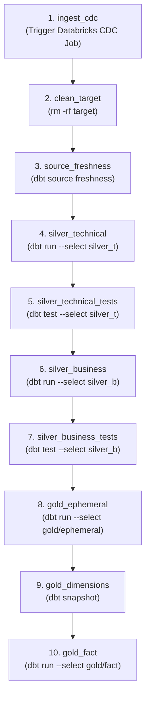
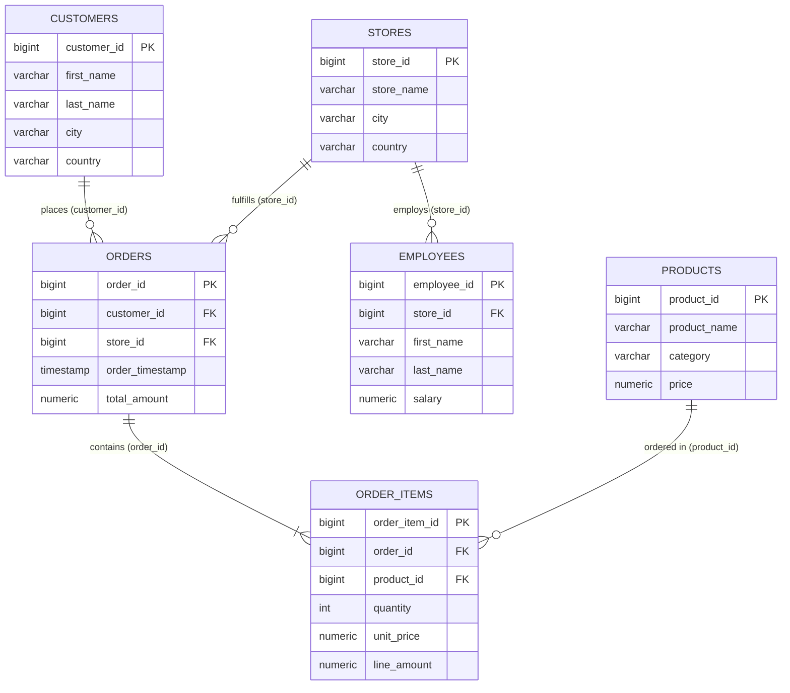
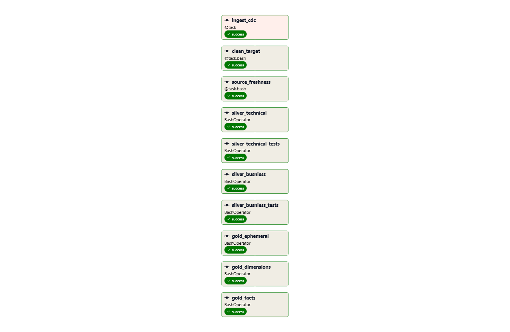
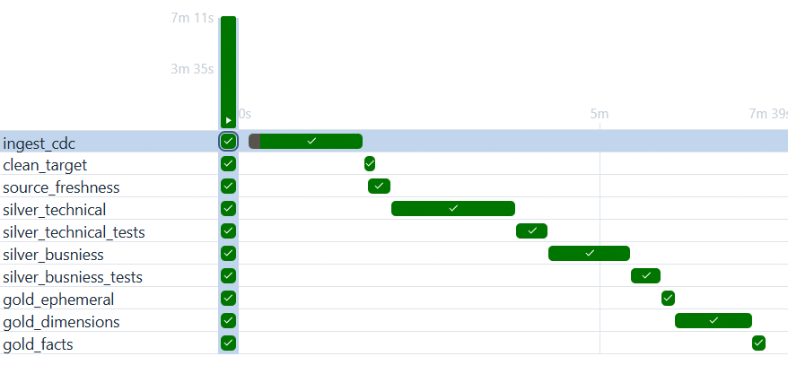

# ⚡ Airflow, dbt Core & Docker Orchestration Guide
### Production Lakehouse Pipeline: Databricks Workflows, dbt Medallion Architecture & Containerized Airflow

[](../README.md)
[](../Walmart%20Neon%20DB%20Postgres%20Setup/README.md)

---

## 📖 Overview

This module is the operational core of the data platform. It orchestrates:
1. **Databricks CDC Workflow**: Triggering external ingestion jobs via the official Databricks SDK (`WorkspaceClient`).
2. **dbt Core on Databricks**: Executing multi-layer SQL transformations (Silver Technical ➔ Silver Business OBT ➔ Gold Marts) inside the Airflow environment.
3. **Data Quality & Freshness**: Automated testing (`dbt test`, custom SQL tests, source freshness checks).
4. **SCD Type 2 Snapshots**: Historical change tracking using `dbt snapshot`.

The entire stack is packaged with **Docker Compose**, running **Apache Airflow 3.4.0** with **CeleryExecutor**, **Redis**, and a dedicated **PostgreSQL metadata database**.

---

## 🏗️ Airflow Architecture & Services

The Docker stack defines a production-style, horizontally scalable Airflow cluster:

```
                          ┌────────────────────────┐
                          │   Airflow Webserver    │ (Port 8080)
                          └───────────┬────────────┘
                                      │
 ┌──────────────────────┐ ┌───────────▼────────────┐ ┌──────────────────────┐
 │   Airflow Worker     │ │   Airflow Scheduler    │ │   Airflow Triggerer  │
 │ (Executes dbt & SDK) │ │  (Evaluates DAG state) │ │ (Async event waits)  │
 └──────────┬───────────┘ └───────────┬────────────┘ └──────────┬───────────┘
            │                         │                         │
            └─────────────────────────┼─────────────────────────┘
                                      ▼
                        ┌───────────────────────────┐
                        │ Redis (Message Broker)    │
                        │ Postgres (Metadata DB)    │
                        └───────────────────────────┘
```

Shared volumes mounted into `/opt/airflow/`:
- `./dags` ➔ `/opt/airflow/dags`: Airflow DAG scripts.
- `./walmart_project` ➔ `/opt/airflow/walmart_project`: Complete dbt project models, macros, snapshots, and tests.
- `./logs` ➔ `/opt/airflow/logs`: Task logs.
- `./config` ➔ `/opt/airflow/config`: Airflow configuration.

---

## 🛠️ Prerequisites

1. **Docker Desktop** installed and running with at least 4GB RAM allocated.
2. **Databricks Account & Workspace** (AWS, Azure, or GCP).
3. **Databricks Serverless / Classic SQL Warehouse** running.
4. **Databricks Personal Access Token (PAT)**.

---

## 🚀 Step-by-Step Setup

### Step 1: Configure Environment Variables

1. In this directory, copy [.env.example](file:///d:/DE_Projects/walmart-de-project-dbt/databricks-dbt-project/.env.example) to `.env`:
   ```bash
   cp .env.example .env
   ```
2. Populate the required values:
   ```ini
   # User ID for container file permissions (50000 is standard)
   AIRFLOW_UID=50000

   # Databricks Workspace & SQL Warehouse Configuration
   DATABRICKS_HOST=https://dbc-3ed3aab1-4e23.cloud.databricks.com
   DATABRICKS_TOKEN=dapi3aef76001758c81e...
   DATABRICKS_HTTP_PATH=/sql/1.0/warehouses/642f62da521a01fd

   # Databricks CDC Ingestion Workflow Job ID
   JOB_ID=627411678856638
   ```

---

### Step 2: Configure dbt Profiles (`profiles.yml`)

dbt connects to Databricks using the `dbt-databricks` adapter.

1. Navigate to the dbt project folder:
   ```bash
   cd walmart_project
   ```
2. Copy [profiles.yml.example](file:///d:/DE_Projects/walmart-de-project-dbt/databricks-dbt-project/walmart_project/profiles.yml.example) to `profiles.yml`:
   ```bash
   cp profiles.yml.example profiles.yml
   ```
3. The profiles configuration dynamically reads from environment variables:
   ```yaml
   walmart_project:
     target: dev
     outputs:
       dev:
         type: databricks
         catalog: walmart
         schema: dbt_schema
         host: "{{ env_var('DATABRICKS_HOST') }}"
         http_path: "{{ env_var('DATABRICKS_HTTP_PATH') }}"
         token: "{{ env_var('DATABRICKS_TOKEN') }}"
         threads: 4
   ```
   > [!IMPORTANT]
   > Never hardcode your tokens or passwords in `profiles.yml`. Using `{{ env_var('...') }}` ensures credentials remain externalized.

---

### Step 3: Configure Airflow Variables

The Airflow DAG [orchestrate.py](file:///d:/DE_Projects/walmart-de-project-dbt/databricks-dbt-project/dags/orchestrate.py) pulls its operational parameters directly from Airflow Variables:

```python
DATABRICKS_HOST = Variable.get("DATABRICKS_HOST")
DATABRICKS_TOKEN = Variable.get("DATABRICKS_TOKEN")
JOB_ID = Variable.get("JOB_ID")
```

Once Airflow is running (Step 4), configure these in the Airflow UI:
1. Navigate to **Admin** ➔ **Variables** in the top navigation bar.
2. Click **+** (Add a new record) and enter each key:

| Variable Key | Description | Example Value | Masked? |
| :--- | :--- | :--- | :--- |
| `DATABRICKS_HOST` | Host URL of your Databricks workspace | `dbc-3ed3aab1-4e23.cloud.databricks.com` | No |
| `DATABRICKS_TOKEN` | Personal Access Token with API permissions | `dapi3aef76001758c...` | **Yes (Hidden)** |
| `JOB_ID` | Databricks CDC Ingestion Workflow Job ID | `627411678856638` | No |
| `DATABRICKS_HTTP_PATH` | Databricks SQL Warehouse HTTP Path | `/sql/1.0/warehouses/642f62da521a01fd` | No |

---

### Step 4: Build and Start the Docker Stack

1. **Build the extended Airflow image** (installs `dbt-databricks`, `databricks-sdk`, and providers from `requirements.txt`):
   ```bash
   docker compose build
   ```
2. **Initialize the Airflow database and default user**:
   ```bash
   docker compose up airflow-init
   ```
   You should see: `Airflow initialization done! Exited with code 0`.
3. **Launch the Airflow services in the background**:
   ```bash
   docker compose up -d
   ```
4. **Verify container health**:
   ```bash
   docker compose ps
   ```
   Ensure `airflow-webserver`, `airflow-scheduler`, `airflow-worker`, `airflow-triggerer`, `postgres`, and `redis` are healthy.

---

### Step 5: Understanding the DAG Tasks & Dependencies

The pipeline DAG **`orchestrate`** defines the complete data pipeline lifecycle:

```python
ingest_cdc() >> clean_target() >> source_freshness() >> silver_technical >> silver_technical_tests >> silver_business >> silver_business_tests >> gold_ephemeral >> gold_dimensions >> gold_fact
```



#### Task Breakdown:
- **`ingest_cdc` (TaskFlow Python)**: Uses Databricks SDK `WorkspaceClient` to trigger `jobs.run_now(job_id=JOB_ID)` and polls every 5 seconds until the job reaches `TERMINATED` + `SUCCESS`.
- **`clean_target` (Bash)**: Removes previous build artifacts (`rm -rf /opt/airflow/walmart_project/target`).
- **`source_freshness` (Bash)**: Verifies bronze tables meet max staleness criteria before transformation.
- **`silver_technical` & Tests**: Cleans nulls, casts data types, and runs `not_null` and `unique` generic tests.
- **`silver_business` & Tests**: Builds the wide denormalized model `obt_b.sql` (One Big Table) and runs custom assertion tests in [test_obt.sql](file:///d:/DE_Projects/walmart-de-project-dbt/databricks-dbt-project/walmart_project/tests/test_obt.sql).
- **`gold_ephemeral`**: Compiles lightweight ephemeral models.
- **`gold_dimensions`**: Runs `dbt snapshot` on dimensions (`dim_customers`, `dim_products`, `dim_stores`, `dim_employees`, `dim_orders`) using SCD Type 2 tracking (`dbt_valid_from`, `dbt_valid_to`).
- **`gold_fact`**: Builds the production analytical star schema fact table `fct_orders`.

---

### Step 6: Data Source ER Model & dbt Denormalization Strategy

To understand how dbt models the data, here is the relational source ER diagram and how `obt_b.sql` consolidates it:



In [obt_b.sql](file:///d:/DE_Projects/walmart-de-project-dbt/databricks-dbt-project/walmart_project/models/silver_b/obt_b.sql), dbt executes automated dynamic left joins starting from `orders_t`:
1. `orders_t` ➔ `customers_t` ON `customer_id`
2. `orders_t` ➔ `order_items_t` ON `order_id`
3. `order_items_t` ➔ `products_t` ON `product_id`
4. `orders_t` ➔ `stores_t` ON `store_id`
5. `orders_t` ➔ `employees_t` ON `store_id`

This flattens normalized relational transactions into an analytics-ready wide table with automated schema-drift detection.

---

### Step 7: Triggering & Monitoring

1. Open your browser and navigate to:
   ```text
   http://localhost:8080
   ```
2. Log in with the default credentials:
   - **Username**: `airflow`
   - **Password**: `airflow`
3. Toggle the switch to **Unpause** the `orchestrate` DAG.
4. Click the **Trigger DAG** (▶️) button to execute a manual pipeline run.
5. Click on the DAG to monitor:
   - **Graph View**: Real-time visual status of each task step.
   - **Gantt Chart**: Execution latency profiling across Databricks ingestion vs dbt compilation.
   - **Task Logs**: Drill into individual dbt model build logs.




---

### Step 8: Testing dbt Models Locally (CLI)

If you wish to test dbt transformations locally outside Docker:

```bash
cd databricks-dbt-project/walmart_project

# 1. Test database connectivity
dbt debug

# 2. Check source freshness
dbt source freshness

# 3. Run Silver Technical models
dbt run --select silver_t

# 4. Run tests
dbt test --select silver_t

# 5. Execute snapshots
dbt snapshot

# 6. Run Gold models
dbt run --select gold
```

---

## 🛑 Stopping the Airflow Stack

To gracefully stop and shut down the cluster:
```bash
docker compose down
```

To stop containers and wipe volume data (clean slate):
```bash
docker compose down -v
```

---

## 🎯 Wrap Up

You now have a fully reproducible, automated, enterprise-grade Data Engineering pipeline! 

[](../README.md)
